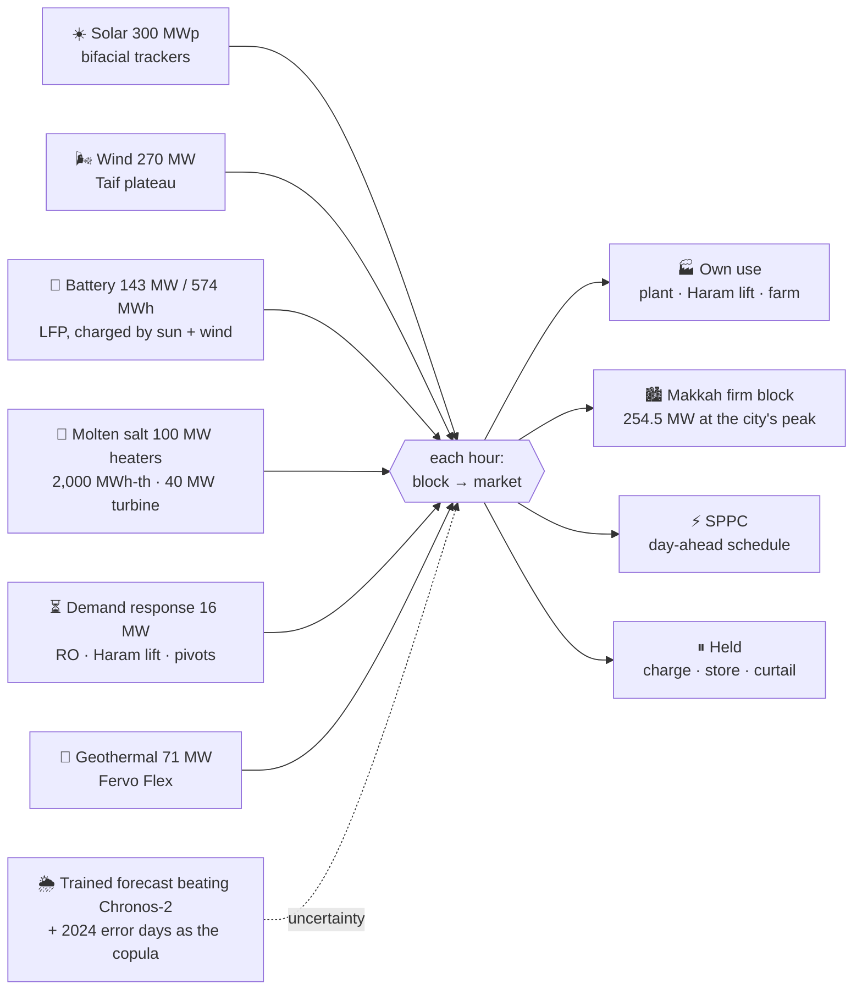
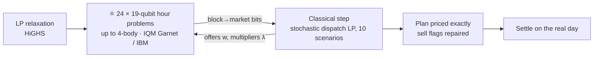

# QEST Hack · Team KRATTRADE · energy

**Joint optimisation of a hybrid portfolio, on a real plant.** A water reclamation plant in Makkah runs on a solar field
with a molten-salt store, a wind park on the Taif plateau, a battery, its own flexible loads and a Fervo-style geothermal
field, all at the same time. For every hour of tomorrow, the plant decides which asset to offer to which market. It works
under forecast uncertainty and pays for imbalance. **The owner's order:** the water treatment first; what the sun and wind
make beyond it fills the battery; only then is anything sold. The salt is the solar field made firm (heated by the PV
alone, it runs a turbine at night and through cloud and dust); the battery charges from the sun and the wind and covers
their off hours. **Firm power** (steady, near-fixed delivery) is the point: a 254.5 MW block for Makkah (at the city's peak hour), shaped by the city's demand.



## 0 · The grown portfolio: solar + wind + battery + demand response + geothermal

The challenge as set: *batteries, solar and wind parks and demand response managed as one portfolio; every hour, which
asset to which market, under forecast uncertainty and imbalance costs; the combinations grow quickly with every asset.*

| Asset (2029) | Model | Built |
|---|---|---|
| ☀️ Solar 300 MWp | pvlib bifacial trackers, ERA5 + CAMS dust; field sited on 480 ha of open ground 8 km NNW of the plant (WorldCover + DEM + Overture buildings/roads) | yes |
| 🌬️ Wind, Taif plateau | 60 × Vestas V163-4.5 MW, DTU PyWake with Ørsted's TurbOPark wakes; CF 32 % (46 % at night), wake loss 11 % | **270 MW** (+$15.6 M a year) |
| 🌊 Wind, Red Sea shelf | 30 × SG 14-236 DD on monopiles, 8-45 m reef shelf (SRTM30+ bathymetry); CF 23 % | no: forcing it costs $91 M a year |
| 🔋 Battery | PowerTitan 3.0, 6.9 MWh blocks; charges from PV and wind only | 143.4 MW / 573.5 MWh |
| 🧂 Molten salt | PV-to-heat into two-tank solar salt (290 → 565 °C), steam turbine at 39 %; heated by the PV alone | 100 MW / 2,000 MWh-th / 40 MW ($90 M; **+$4.7 M a year** against the salt-free optimum) |
| ⏳ Demand response | RO high-pressure pumps (45 %), Haram lift wet well (30 %), night pivots; 4 h owed at most, 3 % rebound | 16 MW |
| 🌋 Geothermal | 59 MW + Fervo Flex train | 71 MW |
| Markets | own use · Makkah firm block (254.5 MW at its peak, shaped by Makkah's demand, 95 % in the Hajj week) · Makkah grid (SPPC) schedule · held | |

**Firm power over the year (energy.sizing, 5 Nov: Makkah's demand set on SEC's measured 4,154 MW):** the Makkah firm
block (254.5 MW at Makkah's peak hour, following the city's demand shape) is met from the portfolio itself in 96.3 % of
hours over the year and in 86.3 % of the Hajj week's hours; at least 117.2 MW leaves the fence in 90 % of hours (mean
203 MW), and the hour-to-hour swing is 44 % of the mean. That is 7.6 % of Makkah's yearly demand, 5.6 % in the Hajj week
(peak 4,320 MW). The salt carries 8.7 % of the PV's energy (63 GWh) into night and cloud.

9 blocks × 4 markets + a sell flag: **2 × 4⁹ = 524,288 plans an hour, 19 qubits** in a binary encoding (2 qubits a block,
no one-hot penalties; IQM Garnet has 20). Wind day-ahead error is 0.24-0.28 per MW installed (solar: 0.04), so the scenarios spread far wider.


### Every method on four real days, settled on the real weather

Rain (4 Mar), Hajj peak (23 Apr), dust storm (4 May), clear July (15 Jul) 2029: each plan is made on the forecast's
scenarios, then the real day happens.


Rerun on 30 Oct with the molten salt (9 blocks, 19 qubits an hour) and our day-ahead forecast (`FORECAST=gbm_c2`), on the sizing of that morning (battery 154.8 MW / 619 MWh; the
final sizing above has 143.4 / 573.5 and a 254.5 MW firm block, the other blocks unchanged):

| Method | Mean vs perfect foresight | Range | Time a day (wall clock, shared machine) |
|---|---|---|---|
| Stochastic MILP (HiGHS, 1 % gap) | **−7.2 %** | −10.4 to −4.2 % | 243-245 s, **240 s limit hit every day** |
| Moves + **Rydberg-atom MWIS** (QuWorld) | −8.0 % | −12.3 to −5.4 % | 52-87 s |
| Moves + greedy MWIS | −8.0 % | −12.3 to −5.2 % | 55-87 s |
| Moves + exact MWIS | −8.1 % | −12.7 to −5.4 % | 57-210 s |
| ADMM + quantum annealing (SQA) | −12.1 % | −14.3 to −9.4 % | 151-205 s |
| ADMM + QAOA (gate-based) | −12.7 % | −17.6 to −9.0 % | 1,076-2,269 s |
| ADMM + Pauli correlation encoding, 5 qubits (2026) | −13.2 % | −18.0 to −9.5 % | 285-4,610 s |
| ADMM + BF-DCQO (2026) | −13.4 % | −17.3 to −8.9 % | 281-768 s |
| ADMM + simulated annealing | −13.6 % | −18.7 to −9.0 % | 144-223 s |
| ADMM + exact hour problems | −13.7 % | −19.1 to −9.1 % | 270-303 s |
| ADMM + warm-start QAOA | −14.1 % | −19.2 to −9.1 % | 1,050-2,256 s |
| Moves + best single move | −19.5 % | −24.7 to −14.8 % | 102-161 s |
| Owner's priority rule | −21.5 % | −28.2 to −17.3 % | 2 s |

- **The MILP still makes the best plan on average, and on 3 of 4 days.** On the dust-storm day (4 May) the move methods
  beat it by 3.5 points (greedy 94.8 % of perfect, Rydberg 94.6 %, MILP 91.3 %): the MILP stops at its time limit there.
  The classical greedy selector does as well as the emulated Rydberg array, so the win is the move search, not the qubits.
- **Picking which changes to make together is what pays.** Each round applies an independent set of compatible changes
  (QuWorld's move selector): −8.0 % in a quarter to a third of the MILP's time; one change a round reaches −19.5 %.
- **Quantum inside the ADMM loop matches its classical twins, and doesn't beat them.** QAOA, SQA, SA, BF-DCQO and PCE land
  within two points of each other and of the exact hour solver. The loss (−12 to −14 %) is in splitting the day into
  hours, not in the hour solver. (The rows before the salt, 8 blocks, 17 qubits: MILP −7.2 %, moves −7.4 to −7.8 %,
  ADMM −9.7 to −10.9 %; kept in `data/energy/qport_nosalt/`.)
- **Warm-start QAOA is a good hour solver; a good hour solver is not a good day.** Its best shot is the exact optimum in
  72 of 96 hour problems (15-134× more likely than random). Plain QAOA at p = 3: 13 of 96 (2-3×). Both whole-day results
  still sit with simulated annealing, because ADMM's hour problems only approximate the day.
- **Quantum ML on wind:** a classical ridge cuts the Taif day-ahead error 14.8 %, the 8-qubit quantum kernel 10.7 %, the
  variational regressor 6.8 %. QML helps against the raw forecast but not against classical ML.

19-qubit hour instances for QPU scoring: `data/energy/hackathon/hubo_2029-04-23_h*.json`. They hold exact Pauli-Z terms up
to 4-body; `energy.quantum.hubo_circuit(n, terms, gamma, beta)` builds the circuit, and a test checks it equals the simulator.

## 0b · The forecast: beating Chronos-2 (and where quantum stands)

The uncertainty the challenge names is the forecast's. `energy/forecast.py` bids at 10:00 UTC the day before, learns on
2024 and is scored on every hour of 2025 (MAE per MW installed; research/SOTA_2026.md §4 for the sweep):


| | Weather forecast | Chronos-2 (zero-shot) | Our best | vs Chronos-2 |
|---|---|---|---|---|
| Solar | 0.0146 | 0.0160 | 0.0134 (boosted correction + Chronos-2 inputs) | **−16 %** |
| Taif wind | 0.157 | 0.122 | 0.118 (same) | **−3.2 %** |
| Geothermal | 0.0138 | 0.0074 | 0.0072 (Chronos-2 fine-tuned by us, LoRA on 2024) | **−2.7 %** |

Planned with the MILP and settled on the real weather over 61 days of 2029, a trained forecast is worth **+$2.5 M a year**
over the weather forecast and cuts imbalance by 64 %; ours and Chronos-2 earn the same, ours with 12 % less imbalance.
**Quantum and hybrid against the baseline.** The quantum hybrid (boosted correction + a 12-qubit sequence reservoir reading
the 34 hours before the bid + Chronos-2's quantiles, blended month by month with our fine-tuned Chronos-2) beats Chronos-2
on all three sources with one recipe: **solar −17.0 %, wind −4.9 %, geothermal −1.9 %**. Its classical twin (an echo-state
network with the same inputs, size and tuning budget) does as well (−18.3 / −4.7 / −1.6 %), so the qubits add nothing yet;
the reservoir alone, with a linear readout, loses to Chronos-2 (−2.5 / −15.4 / −14.9 %). The GPU statevector is checked
against dense matrices. Quantum's open lines here: joint scenario generation and the hour problems, not point forecasts.

## 1 · The problem, at full size (not a toy)

| | Real portfolio, Phase 1 (2029) | Source |
|---|---|---|
| Solar | 300 MWdc, Jinko Tiger Neo 3.0 670 W bifacial, single-axis trackers | pvlib, ERA5 + CAMS dust, HSU soiling |
| Wind | 270 MW on the Taif plateau, 60 × Vestas V163-4.5 MW | DTU PyWake, TurbOPark wakes, ERA5 + Open-Meteo forecasts |
| Battery | 143.4 MW / 573.5 MWh, Sungrow PowerTitan 3.0 (684 Ah LFP) | PyBaMM SPMe, NREL BLAST-Lite life |
| Demand response | 16 MW: RO pumps, Haram lift wet well, night pivots | the twin's process model |
| Geothermal | 59 MW net + 1 extra ORC train (11.8 MW), 8 producers at 4.1 km, 245 °C | CoolProp ORC, Fervo Flex in-reservoir storage |
| Molten salt | 100 MW heater (PV only) · 2,000 MWh-th · 40 MW turbine: 59.9 GWh of night solar, swing 45 → 40 %, +$4.66 M a year | sizing LP |
| Own use | 12–30 MW plant + 4–10 MW Haram lift + farm | the twin's process model |
| Markets | own use · Makkah firm block · SPPC schedule · held | SEC, SPPC, NREP prices |

**Search space per hour:** 9 blocks × 4 markets + a sell flag = 2 × 4⁹ = 524,288 plans. Per day: 524,288²⁴ ≈ 10¹³⁷.
Every plan is priced across 10 weather scenarios drawn from the forecast's real 2024 errors.


## 2 · State of the art we build on

| Piece | Method | Reference |
|---|---|---|
| Hybrid split | ADMM: classical stochastic LP ⇄ quantum QUBO | Gambella & Simonetto, IEEE QCE 2020 · Mahroo & Kargarian 2022 (QAOA unit commitment) |
| QUBO solver | QAOA, linear-ramp start, angle reuse | Farhi 2014 · Sack & Serbyn 2021 · Brandão 2018 |
| Warm start | warm-start QAOA from the LP relaxation | Egger, Mareček & Woerner, Quantum 2021 |
| Hardware objective | CVaR-0.1 of the shots | Barkoutsos et al., Quantum 2020 |
| Simulation | exact diagonal statevector (as QOKit) | Lykov et al. 2023 |
| Benders alternative | hybrid multi-cut Benders for UC | Paterakis 2023 · ORNL arXiv:2505.00145 |
| QML | quantum kernel (IQP map) · data re-uploading regressor | Havlíček, Nature 2019 · Pérez-Salinas, Quantum 2020 |
| Flexible geothermal | in-reservoir storage | Ricks, Norbeck & Jenkins, Applied Energy 2022 · Fervo Flex test 2023 |
| **2026:** counterdiabatic, non-variational | BF-DCQO, used on trapped ions for large portfolios; ours extended to 4-body hours | arXiv:2602.23976 · 2409.04477 |
| **2026:** qubit compression | Pauli correlation encoding for unit commitment and power-demand portfolios | arXiv:2605.17145 · 2607.24722 · 2609.36999 |
| **2026:** QAOA inside ADMM for UC | distributed QAOA, three-block ADMM: the same split as ours | arXiv:2608.04159 |
| **2026:** honest baselines | hybrid VQA on AC-OPF-UC does not beat random sampling; D-Wave hybrid spends 0.68 % on the QPU | arXiv:2607.15543 · 2605.17623 |

All 2026 papers read, the cloned code, and what we adopted: [research/SOTA_2026.md](../research/SOTA_2026.md).

## 3 · The hybrid algorithm



- **Qubits are fixed at 19 an hour** (2 a block in binary + the sell flag). They don't grow with the horizon or the number of scenarios, because both sit on the classical side.
- **One hour fits on IQM Garnet (20 qubits).** All 24 hours can run in parallel.

## 4 · Results of the first study (6 blocks: solar, battery, geothermal; one-hot, 19 qubits)

The grown portfolio's results are in §0; these are kept because the warm-start and quantum-only findings still hold.


- **Classical MILP:** 95–99.9% of the best possible on all four days.
- **Hybrid (ADMM + warm-start QAOA):** 98.6–99.5% on the dry days and 86% on the rain day, where uncertainty is widest.
  It matches the same loop run with an exact QUBO solver every day.
- **Warm-start QAOA:** optimum in 96/96 hour QUBOs, 375–1,843× more likely than random guessing.
- **Plain QAOA:** misses on penalty-heavy hours, so the dust-storm and July days fall to 67–70%.
- **Quantum alone (one QUBO per hour, no classical loop):** 31–67%. It can't see the battery from hour to hour; the
  classical side of the hybrid supplies that memory.
- **Time:** simulated QAOA on a CPU takes ~45–77 min a day, against ~1 min for HiGHS. On a QPU each of the 24 hourly
  circuits runs in parallel.


Results tables: `web/data/energy/methods.json`, `qml.json`, `scaling.json`, `year.json`, `money.json`.

## 5 · Does quantum pay? (QPU time €30–300k a year)


| 2029, 365 days on real weather · solar + Taif wind + battery + DR + geothermal | Net a year |
|---|---|
| Owner's fixed priority rule | $89.9 M |
| Stochastic MILP (HiGHS, classical) | **$119.8 M** (96.0 % of perfect) |
| Perfect foresight (no solver can beat it) | $124.9 M |

The table above is the year run (energy.year, 5 Nov) on the weather forecast, with the salt store and the 5 Nov sizing:
deciding well is worth $30.0 M a year over the rule, and $5.0 M a year is left for any better solver or forecast. (The
rule sells all it has into the firm block, so its total does not move with the block's size.) On our forecast, the same
split over 61 days of 2029 (every 6th day), settled on the real weather and annualised, on the 30 Oct sizing (battery
151 MW, firm 257.8 MW):

| Today's portfolio, 61 days | Net a year | What it means for quantum |
|---|---|---|
| Owner's fixed rule | $96.3 M | |
| Stochastic MILP, 1 % gap, ~4 min a day | $123.2 M | deciding well is worth **$26.9 M a year**: classical already takes it |
| Perfect foresight | $131.1 M | **$8.0 M a year** is the most any solver *or* forecast could still add |
| MILP solved to 0.01 %, 30 min a day (10 days) | +$1.0 M a year over the 1 % plan (±$1.1 M) | the part a better *solver* can reach; the rest (~$7 M) is weather error |

**Payback of €30–300k a year of QPU time** (€ ≈ $ here):
- **Break-even:** €30k is 3 % of the ~$1 M a better solver can still earn, €300k is 30 %. Against the whole $8 M ceiling,
  0.4 % and 3.8 %.
- **What quantum has earned so far: nothing above classical.** On the test days no quantum or hybrid method beat the MILP;
  the quantum forecast ties its classical twin; in money a forecast better than Chronos-2 earned the same (ours and
  Chronos-2: $20.59 M each over 61 days). On noisy hardware models only the lean BF-DCQO finds the hour optima, and random
  guesses plus a one-bit polish come close.
- **The competitor is more classical time, which is nearly free.** The +$1.0 M came from letting HiGHS run 30 min instead
  of 4 (8 of 10 days still hit the 30-min limit: with the salt and 19 qubits an hour the exact day is hard).
- **Why use it anyway:** the bid closes at 10:00 the day before, so solve time is money once the problem outgrows the
  deadline: whole ORC units with on/off rules, 20+ scenarios, 48 h horizons, more parks (at 3 whole-asset blocks the MILP
  already hits 300 s at every scenario count). Each hour's 19-qubit problem fits
  one 20-qubit chip and all 24 run side by side. The €30k tier pays if quantum-in-the-loop beats a deadline-limited MILP by
  ~$80 a day; €300k needs a third of the solver headroom, which no result here supports yet.
- **Verdict:** buy the €30k tier to test the hard instances on real QPUs (§5b); hold the €300k tier until a hybrid beats
  a 30-min classical solve on them.

| Whole project (with the plant and farm) | Solar + salt + wind + battery + DR + geothermal | Geothermal only |
|---|---|---|
| Build | $1.86 B (Taif park $297 M, salt store $90 M) | $1.21 B |
| Payback after first water | 8.8 y | 8.6 y |
| NPV at 6 % | $692 M | $500 M |
| IRR | 10.0 % | 10.4 % |

Until 29 Oct the money counted the wind park's earnings but not its build ($297 M) or upkeep ($9.5 M a year), and so showed
$1.55 B, 6.9 y and 13.7 %. With both in, wind still pays its way: the sizing study puts it at +$15.6 M a year after its annualised build and upkeep.
On 29 Oct (evening) the trunk sewer moved onto the roads (a lower pass out of the basin, 55 m of lift instead of 124 m), $41 M less to build.

## 5b · Hardware rehearsal, and the work for the three hack days

The four exported Hajj-day hours (`hubo_2029-04-23_h*.json`, 19 qubits with the salt turbine, 4-body; re-run 31 Oct on the Makkah firm-block markets, `data/energy/qpu_makkah/`) were compiled for
IBM Heron (Fez) and IQM's 20-qubit square lattice (Garnet's layout), then run on each device's noise model (`energy/qpu.py`;
no token needed). Each shot is scored by its rank among all 524,288 plans (0 = the optimum, 0.5 = random).


| Method (4 hours) | Two-qubit gates, Heron / IQM | Mean rank: noise-free · Heron · IQM | Hours where a raw shot is the optimum, Heron / IQM | … after the one-bit polish |
|---|---|---|---|---|
| QAOA p = 1, noise-free angles | 109 / 84 | 0.28 · 0.32 · 0.41 | 0 / 0 | 2 / 2 |
| QAOA p = 2 | 244 / 149 | 0.25 · 0.35 · 0.45 | 0 / 0 | 4 / 4 |
| QAOA p = 3 | 351 / 248 | 0.24 · 0.37 · 0.47 | 0 / 0 | 3 / 3 |
| BF-DCQO, every rotation | 644 / 457 | 0.12 · 0.46 · 0.49 | 0 / 0 | 4 / 4 |
| **BF-DCQO lean, 24 largest rotations, 6 feedback runs** | **66 / 46** | **0.08 · 0.15 · 0.31** | **4 / 0** | **4 / 4** |
| Uniform random, 1,024 / 4,096 shots | — | 0.50 | 0 / 0 | 3 / 2 |

- **Only the lean BF-DCQO survives the noise, at 19 qubits as at 17.** Its bias feedback, measured on the noisy device,
  walks the shots to rank 0.15 on Heron (0.11 at 17 qubits), and some raw shot is the exact optimum in all 4 hours on
  Heron (none raw on IQM's older noise model, all 4 after the polish). The full circuit (~450-530 two-qubit gates) and every QAOA depth land near random; deeper QAOA does worse under
  noise, not better.
- **The polish is strong, even from random.** Random bitstrings plus the one-bit descent reach the optimum in 2-3 of 4
  hours. Hardware has to beat random-plus-polish, not raw random; lean BF-DCQO does (4 of 4 on both).
- **Growing 17 → 19 qubits** added ~10 % more two-qubit gates and cost the lean circuit 0.03-0.04 in rank; it still fits
  one IQM Garnet chip (20 qubits).
- **Budget:** lean BF-DCQO used 6 × 1,024 shots per hour. The 17-qubit runs are kept in `data/energy/qpu17/`.
- **Caveat:** IQM's public noise model is the older Apollo calibration, not Garnet's; expect Garnet to sit nearer Heron.

**For the hack days:**
1. Run lean BF-DCQO on IQM Garnet and IBM Heron (`.env` tokens, `energy.quantum --backend ibm|iqm` with `energy.qpu`'s
   circuits), 6 feedback runs per hour, and score against the files' optima.
2. ~~XY-mixer QAOA~~: dropped. The binary encoding (2 qubits a block) has no one-hot constraint left to keep, and under
   noise QAOA loses to the lean BF-DCQO anyway.
3. **Hard instances:** whole ORC units with minimum up/down times, 20+ scenarios, 48 h horizons. This is where HiGHS
   slows (the dispatch model is fixed at 24 h today).

## 6 · Data set for the teams

`data/energy/hackathon/`:

| File | What |
|---|---|
| `hourly_2029.csv` | 8,760 h: PV per MWdc (actual, forecast, no-dust, clean), wind per MW (Taif, Red Sea; actual, forecast), geothermal MW, loads, DR flexibility, day type, prices |
| `portfolio.json` | sizes, the 9 blocks, markets, rules, the 19-qubit binary layout |
| `forecast_errors_2024.csv` | the PV, wind and geothermal errors the scenarios draw from |
| `hubo_2029-04-23_hHH.json` | the grown portfolio's 19-qubit hour problems (with the salt turbine) as Pauli-Z terms up to 4-body, with the exact optimum, for QPU scoring |
| `qubo_2029-04-23_hHH.json` | the first study's 19-qubit one-hot Ising instances (frozen) |

## 7 · Run it

```bash
scripts/setup_env.sh                                              # .venv, .venv-energy, .venv-iqm
.venv/bin/python -m energy.qpu                                    # hardware rehearsal: IBM Heron + IQM noise models, no token
.venv/bin/python -m energy.hourbench                              # every hour solver on 96 real hour problems
.venv/bin/python -m energy.qport --day 2029-04-23                 # grown portfolio: every method (GPU 0)
.venv/bin/python -m energy.qport --scaling                        # 5 -> 22 blocks
.venv-energy/bin/python -m energy.qml --target wtaif              # QML on the wind forecast
.venv-energy/bin/python -m energy.quantum --day 2029-04-23 --compare  # every method on one day
.venv-energy/bin/python -m energy.quantum --day 2029-04-23 --solver qaoa --backend iqm   # IQM_TOKEN in .env
.venv-energy/bin/python -m energy.quantum --day 2029-04-23 --solver qaoa --backend ibm   # IBM_QUANTUM_TOKEN in .env
.venv-energy/bin/python -m energy.qml                             # quantum vs classical forecast correction
```
