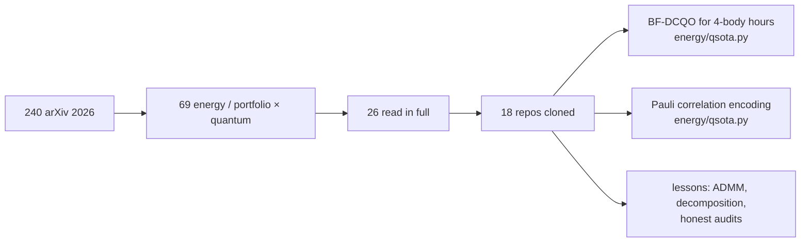

# Quantum for energy portfolios: what 2026 brought, and what we took from it

**How the search was done (29 Oct 2026):**
- arXiv API, 16 queries, submissions dated 2026 only: 240 papers.
- 69 of them pair an energy or portfolio problem with a quantum method; 26 read in full text.
- Code linked in 11 of those 26; 7 more 2026 repositories found on GitHub. All cloned into `research/third_party/` (not committed: each keeps its own licence).
- Three 2025 foundations that the 2026 work builds on are included.

## 1 · The 2026 papers that matter for this portfolio

| arXiv (2026) | What it does | Code | What we did with it |
|---|---|---|---|
| [2605.17145](https://arxiv.org/abs/2605.17145) Nguyen, Safro, Liu | Unit commitment, leader-follower: quantum picks on/off, classical dispatch; **Pauli correlation encoding** scales to horizon-wide schedules (312 binaries) | not public | **adopted** PCE for our hour problems (`qsota.pce`) |
| [2607.24722](https://arxiv.org/abs/2607.24722) | PCE for power-demand portfolios, m = 18 to 10,296, gaps ~1e-4; a time-averaged stage warm-starts the time-resolved one; runs on trapped ions | not public | same; the two-stage warm start is our ADMM's LP-relaxation warm start |
| [2609.36999](https://arxiv.org/abs/2609.36999) | UC with PCE (fewer qubits) + sample-based quantum diagonalisation (SQD) refinement | "after publication" | SQD on a diagonal cost reduces to "best of the sampled set + recovery"; our one-bit polish plays that part |
| [2608.04159](https://arxiv.org/abs/2608.04159) | **Distributed QAOA inside three-block ADMM** for UC; commitment qubits split over several small QPUs | — | the same split as ours (energy/quantum.py, energy/qport.py): independent confirmation; ours runs 24 hour problems in parallel |
| [2607.15543](https://arxiv.org/abs/2607.15543) Gaidai et al. | First benchmark of hybrid VQA on full AC-OPF-UC, 5-13 generators: **the qubit-efficient hybrid does not beat uniform random sampling** | [PowerGridQuantumOpt](https://github.com/GaidaiIgor/PowerGridQuantumOpt) | cloned; supports our "match, not beat" finding |
| [2602.23976](https://arxiv.org/abs/2602.23976) JPMorgan + IonQ | Large portfolios on trapped ions: decompose into qubit-sized clusters, solve each by **BF-DCQO** (non-variational) | [dcmppln](https://github.com/jpmorganchase/dcmppln) | **adopted** BF-DCQO (`qsota.bfdcqo`), extended to 4-body costs |
| independent notebook | BF-DCQO step by step in Qiskit, 25 assets, with the sign errors of the papers worked out | [bf-dcqo-qiskit](https://github.com/tommaso-corti/bf-dcqo-qiskit) | read line by line; its closed-form α covers 2-body only, so ours uses exact Pauli algebra |
| [2609.15708](https://arxiv.org/abs/2609.15708) | Context-Aware Folding: inject global risk into each local sub-problem (QAOA, SQA local solvers) | [CAF](https://github.com/kedayxg/CAF) | cloned; ADMM's multipliers λ are our global context |
| [2603.00260](https://arxiv.org/abs/2603.00260) | Copula-QAOA: biased initial states + shallow mixers; single-period UC as knapsack on 150 IBM qubits, close to Gurobi | — | our warm-start QAOA is the same idea (biased start) |
| [2605.06858](https://arxiv.org/abs/2605.06858) | Constrained counterdiabatic QAOA (XY mixer + CD terms) beats XY, Grover and penalty QAOA at fixed depth | [OpenQuantumComputing/QAOA](https://github.com/OpenQuantumComputing/QAOA) | cloned; our binary encoding has no constraint left to preserve |
| [2602.21562](https://arxiv.org/abs/2602.21562) | Mixers for 3-state portfolios: XY mixers win without noise, lose it with noise | [QAOA-Ternary-Portfolio](https://github.com/Shintaro-Yamamura/QAOA-Ternary-Portfolio) | our blocks have 4 states; binary = 2 qubits a block vs one-hot + XY = 4 |
| [2610.00736](https://arxiv.org/abs/2610.00736) | Which feasible states a shallow constrained QAOA can reach at all | — | why we left the one-hot form |
| [2604.19426](https://arxiv.org/abs/2604.19426) | Noise compresses the constrained-QAOA landscape on IBM Heron, worse with circuit size (n = 6-16) | [qaoa-noise-landscape](https://github.com/dmeliksetian/qaoa-noise-landscape) | cloned; warning for the 17-qubit hardware runs |
| [2605.17623](https://arxiv.org/abs/2605.17623) | **Audit of D-Wave hybrid**: matches Gurobi up to N = 120, but QPU access is 0.68 % of the time budget | [where-quantum-lives](https://github.com/LuisLozanoM/where-quantum-lives) | method followed: we time the quantum step apart from the classical one |
| [2605.17628](https://arxiv.org/abs/2605.17628) | Penalty-free pipeline for direct QPU portfolios | [penalty-free-portfolio](https://github.com/LuisLozanoM/penalty-free-portfolio) | cloned |
| [2601.18811](https://arxiv.org/abs/2601.18811) | Quantum RL (VQC DDPG/DQN) for dynamic portfolios, on par with deep RL at far fewer parameters; cloud latency limits it | [qrl-dpo-public](https://github.com/VincentGurgul/qrl-dpo-public) | cloned; next step: intraday battery/DR recourse agent |
| [2606.22542](https://arxiv.org/abs/2606.22542) | Quantum RBM predicts UC patterns: −99.96 % time, 276× fewer qubits | — | not adopted (needs a learned pattern library) |
| [2603.07823](https://arxiv.org/abs/2603.07823) | Hierarchical quantum annealing MPC, households with hydrogen storage | — | same day-ahead/short-term split as ours |
| [2605.10255](https://arxiv.org/abs/2605.10255) | Qubit vs qudit encodings for EV charging + trips | — | binary encoding choice |
| [2601.01777](https://arxiv.org/abs/2601.01777) | Survey: quantum computing for unit commitment | — | reading list |
| 2026 GitHub | [quantumgrid](https://github.com/ajliouat/quantumgrid) (UC on ENTSO-E), [xQAOA_unit_commitment](https://github.com/jhoule42/xQAOA_unit_commitment), [Rigetti grid challenge](https://github.com/AshrafBoussahi/Rigetti_Quantum_Grid_Optimization_eQoSystem), [PCE finance](https://github.com/vicentesolovievfujitsu/pce_finance), [CESGA PCE benchmark](https://github.com/csampron/CESGA-Quantum-Spain-PCE-Benchmark), [QAOA carbon credits](https://github.com/hgribeirogeo/qaoa-carbon-cerrado) | cloned | |

**2025 foundations:**
- BF-DCQO for higher-order problems: [arXiv:2409.04477](https://arxiv.org/abs/2409.04477), Commun. Phys. 2025. Its runtime-advantage claim is [arXiv:2505.08663](https://arxiv.org/abs/2505.08663).
- PCE: Sciorilli et al., [Nat. Commun. 16, 476](https://arxiv.org/abs/2401.09421).
- Decoded quantum interferometry: Jordan et al., Nature 646 (2025). No energy application yet.

## 1b · October 2026 update (sweep of 29 Oct 2026)

arXiv API (8 queries, submitted 25 Sep - 29 Oct 2026), OpenReview (ICLR 2027 submissions, 7 queries) and the GitHub API
(9 queries, repositories created since May 2026). 33 new arXiv papers, 12 relevant; 2 OpenReview submissions; 11 new
repositories cloned into `research/third_party/`.

| Paper (Oct 2026) | What it shows | Code | What we did with it |
|---|---|---|---|
| [2610.23296](https://arxiv.org/abs/2610.23296) Jakubik et al. (IBM) | A model maps the instance to its QAOA angles in one forward pass, orders of magnitude faster than training, near-equal quality | [qaoa_ai_model_training](https://github.com/jhnnsjkbk1/qaoa_ai_model_training) | **adopted**: ridge on the hour cost's Pauli coefficients (our hours share one structure) |
| [2610.19544](https://arxiv.org/abs/2610.19544) Boussahi | PCE's loss sharpness is a hidden shot budget: alpha = 0.851 sqrt(S) matches S-shot decoding; exact-expectation schedules lose their edge at real budgets | — | **adopted** as an option in `qsota.pce` and tested at 256 and 4,096 shots |
| [2610.35126](https://arxiv.org/abs/2610.35126) Hellstern et al. | 180 QUBOs: with optima moved to random bitstrings, branch-and-cut finds 4/10 at n = 48 while parallel tempering finds all | — | **adopted**: parallel tempering as the classical bar (`qsota.ptemper`) |
| FALQON for unit commitment (2026 repo; Magann et al. PRL 2022) | Feedback-set mixer angles, no training; 24/24 hours optimal on a 4-unit UC | [Unit-Commitment-Quantum-Opt](https://github.com/Cairo-Henrique/Unit-Commitment-Quantum-Opt) | **adopted**: `qsota.falqon` on our 4-body hours |
| [2610.10772](https://arxiv.org/abs/2610.10772) Liaqat et al. | 1,710-variable problem on the PEGASE 1,354-bus grid: one-layer QAOA sampling + Frank-Wolfe + spectral partitions of <= 50 qubits on IBM hardware | — | the route past 25 qubits: partition the blocks; not needed at 17 qubits |
| [2610.03949](https://arxiv.org/abs/2610.03949) | PCE on MIS: higher compression hits representability limits from Pauli closure | — | consistent with our 4-qubit PCE losing to 5 qubits |
| [2610.01904](https://arxiv.org/abs/2610.01904) | Coordinate descent for multi-angle QAOA on MIS | — | candidate for the Rydberg MWIS selector |
| [2609.38800](https://arxiv.org/abs/2609.38800) (IBM) | Variance-reduced recycled gradients cut circuit calls for VQA training | — | for a real QPU run; on the simulator we use exact gradients |
| [2609.40327](https://arxiv.org/abs/2609.40327) | Quantum-enhanced Q-networks for distribution network reconfiguration: higher reward, fewer parameters | — | with 2601.18811, the QRL path for intraday recourse |
| [2610.26687](https://arxiv.org/abs/2610.26687) | Penalty QA approaches constrained (XY) QA's ground-state sampling at large penalties | — | supports our penalty encoding of "sell needs r" |
| [2610.33386](https://arxiv.org/abs/2610.33386) | Zero-noise extrapolation can improve accuracy yet pick worse QAOA angles | — | caution for the QPU export |
| [2610.09798](https://arxiv.org/abs/2610.09798) (TCS) | Finance MILP -> QUBO -> PCE on IBM hardware | — | same pipeline as ours |
| OpenReview: [BOLT-DA](https://openreview.net/forum?id=lTgDrnvdsT) (ICLR 2027 subm.) | Shot-efficient depth-aware QAOA | — | reading |
| OpenReview: [Distributed quantum GBD for UC](https://openreview.net/forum?id=v18qRtvGI4) (QIP 2025) | Generalised Benders with quantum master problems | — | same split as our ADMM |

New 2026 repositories cloned: [parallel-coordinated-qaoa](https://github.com/USN-Quantum-Research/parallel-coordinated-qaoa) (distributed QUBO-QAOA for energy-system planning, PyPSA, published),
[DQAOA](https://github.com/LSU-RAISE-LAB/DQAOA) (distributed QAOA simulator), [qugrid](https://github.com/TravisCao/qugrid) (MATPOWER case to quantum algorithm),
[quantum-solar](https://github.com/austinamissah/quantum-solar) (QAOA home-battery scheduling under time-of-use; its LESSONS.md: penalty 48x too large made QAOA optimise the wrong thing; gate count, not qubit count, binds on hardware),
[quantum-grid-intelligence](https://github.com/QuantumHackathon/quantum-grid-intelligence) (multi-angle warm-start QAOA, grid partitioning), [gqe-portfolio-demo](https://github.com/JesU2504/gqe-portfolio-demo) (generative quantum eigensolver, CUDA-Q),
[CESGA PCE factorisation](https://github.com/faf393/CESGA-Quantum-Spain-PCE-Factorisation), [PCE vs QAOA on noisy hardware](https://github.com/tomas10caetano/terative-alpha-PCE-vs-QAOA), [constraint-preserving portfolio QAOA](https://github.com/emjayy13/QAOA-Portfolio-Optimization).

### The October methods, scored on the real hour problems (`energy/hourbench.py`)

96 hour problems of the Hajj peak day (23 Apr 2029): the 24 hours at ADMM iterations 0, 6, 12 and 23, 17 qubits, costs up
to 4-body. Learned angles are trained on the hours of 8-12 Apr (480 hours). Every solver runs once, then the one-bit polish;
a tie counts as optimal. "× random" is the median weight the final state puts on the optimum, over 1/2¹⁷.

| Hour solver | At the optimum | Time, 96 hours | Training | × random |
|---|---|---|---|---|
| Exact (2¹⁷ table) | 96/96 | 0.1 s | — | |
| **BF-DCQO, 4-body** | **96/96** | 13.4 s | none | **246** |
| Simulated annealing | 90/96 | 5.5 s | none | |
| Parallel tempering (2610.35126) | 80/96 | 1.5 s | none | |
| Warm-start QAOA, p = 3 | 80/96 | 15.6 s | Adam, 150 steps | 101 |
| PCE, 5 qubits, 256 shots, α = 1.5k | 71/96 | 39.2 s | Adam, 24 restarts | |
| Simulated quantum annealing | 70/96 | 2.2 s | none | |
| PCE, 5 qubits, exact correlators | 70/96 | 42.6 s | Adam, 24 restarts | |
| PCE, 5 qubits, 4,096 shots, α = 1.5k | 70/96 | 88.1 s | Adam, 24 restarts | |
| FALQON, 300 layers | 68/96 | 3.0 s | none (feedback) | 2.1 |
| PCE, 5 qubits, 256 shots, α = 0.851√S (2610.19544) | 67/96 | 53.3 s | Adam, 24 restarts | |
| QAOA, p = 3 | 64/96 | 19.6 s | Adam, 150 steps | 2.5 |
| **QAOA, p = 3, learned angles (2610.23296)** | 59/96 | **0.1 s** | one ridge pass, 42 coefficients | 2.5 |
| QAOA, p = 3, median angles | 52/96 | 0.0 s | none | 2.5 |
| PCE, 5 qubits, 4,096 shots, α = 0.851√S (2610.19544) | 52/96 | 156.5 s | Adam, 24 restarts | |

- **BF-DCQO is still the only hour solver at 96/96,** classical or quantum, with nothing to train. It beats simulated
  annealing (90) on these later-iteration hours.
- **Learned angles work as the paper says:** 59 of the 64 hours that per-instance Adam reaches, ~200× faster. They beat
  reusing the median angles (52). Plain QAOA at p = 3 is the weak base either way (2.5× random).
- **Parallel tempering does not help at 17 qubits** (80 vs SA's 90). Its edge in 2610.35126 shows at n = 48.
- **The shot-aware PCE schedule did not carry over.** α = 0.851√S is worse than a fixed α at both budgets, and much
  worse at 4,096 shots (52 vs 70). Our 4-body costs aren't the MaxCut costs it was fitted on. We keep the fixed α.
- FALQON reaches 68/96 with no training. Its state is close to uniform (2.1× random), so the polish does most of the work.

## 2 · What we built from it, on the real portfolio's hours

The Hajj peak day's 24 hour problems: 8 blocks, 17 qubits, costs up to 4-body. Each solver ran with one seed, then the
one-bit polish. A tie counts as optimal.

| Hour solver | Hours at the optimum | Time for 24 hours | Training |
|---|---|---|---|
| **BF-DCQO, 4-body** (new) | **24/24** | 1.1 s | none |
| Simulated annealing | 24/24 | 0.3 s | none |
| Simulated quantum annealing | 21/24 | 0.5 s | none |
| Warm-start QAOA, p = 3 | 19/24 | 3.0 s | Adam |
| QAOA, p = 3 | 14/24 | 2.4 s | Adam |
| PCE, 5 qubits for 17 bits (new) | 16/24 | 4.6 s | Adam, 24 restarts |
| PCE, 4 qubits (the minimum) | 14/24 | 4.5 s | Adam |

- **BF-DCQO is the strongest quantum hour solver we have.** Its state puts ~100× the random-guess weight on the optimum, with no parameters to train. Ours computes α from the exact Pauli algebra of the 4-body cost; the published closed form covers 2-body only.
- **PCE trades accuracy for qubits.** 17 bits fit on 4-5 qubits, 45 bits (22 blocks) on 6-7. That's the only method here whose qubit count grows like √(bits), but at this size it reaches the optimum less often.
- Neither beats simulated annealing. That agrees with 2607.15543 (no gain over random sampling on AC-OPF-UC) and with the D-Wave audit (2605.17623).

Tests: `tests/test_qsota.py`. α matches dense matrices on 3-body costs, the Y·Z rotation matches expm, and both solvers find a small hour's optimum.

### Whole days, inside the hybrid loop (4 real days, settled on the real weather)

| ADMM hour solver | Mean vs perfect foresight | Time a day |
|---|---|---|
| QAOA | −9.7 % | 173-205 s |
| Simulated annealing | −9.9 % | 109-123 s |
| Pauli correlation encoding, 5 qubits (new) | −10.0 % | 480-501 s |
| Simulated quantum annealing | −10.2 % | 117-128 s |
| BF-DCQO (new) | −10.3 % | 180-202 s |
| Exact enumeration | −10.7 % | 99-116 s |
| Warm-start QAOA | −10.9 % | 150-199 s |
| *for scale: stochastic MILP* | *−7.2 %* | *266-302 s* |
| *for scale: moves + Rydberg MWIS (QuWorld)* | *−7.8 %* | *46-62 s* |

**Lesson for the hack:** a better hour solver does not make a better day. The whole spread is 1.2 points, and exact enumeration is not at the top. ADMM's hour problems only approximate the day. Quantum effort pays more where it picks the joint changes to the whole day, as QuWorld's move selector does.

## 3 · Not adopted yet, and why

| Idea | Why not now |
|---|---|
| Quantum RL for intraday recourse (2601.18811) | KSA has no intraday market yet; worth doing for EE mode (Nord Pool intraday + Elering balancing) |
| SQD refinement (2609.36999) | on a diagonal cost it adds nothing beyond the polish we already run |
| qRBM pattern prediction (2606.22542) | needs a library of solved days; the year run (365 MILP days) can provide one |
| DQI (Nature 2025) | no energy formulation yet; needs fault-tolerant scale (~5.7 M Toffolis) |

## 4 · Forecasting: quantum methods against Chronos-2 (30 Oct 2026)

The hackathon's uncertainty is the day-ahead forecast; better forecasts cut imbalance before any optimiser runs. Sweep of
2025-26 quantum forecasting work with code, and the time-series foundation model to beat.

| Work | What | Code | Taken? |
|---|---|---|---|
| Chronos-2 (Amazon, arXiv 2510.15821) | 120 M foundation model; known-future covariates (`predict(..., future_covariates)`), LoRA fine-tuning (`fit`) | amazon-science/chronos-forecasting | **the baseline**, zero-shot and fine-tuned |
| QRC for load forecasting (arXiv 2606.12806, 2604.06075) | quantum reservoir, meteorological covariates, 6-bit readout | none found | the method (reservoir + ridge) |
| ResQue (Global Industry Challenge 2026) | transverse-field Ising QRC, data re-uploading, Z and X readout, PCA to the qubits, ridge readout | Armstrong66/resque-qrc | **the template** for `energy/forecast.py` (GPU statevector, batched) |
| Distributed QRC (arXiv 2605.04991) | QRC across modules, power-load task | — | no: scale is not our limit |
| Variational benchmark (Fellner et al., MLST 2026, arXiv 2504.12416) | 27 tasks: VQC / QLSTM / QRNN rarely beat small classical models | yes | the warning: always run a classical twin of the same size |
| Hybrid VQC wind (Rishabh-bgp, 2026) | Conv1D-LSTM + 4-qubit VQC on SCADA wind | yes | no: simulator-only, no baseline |
| QLSTM + VMD for irradiance (Sci. Rep. 2026) | decomposition + improved QLSTM | no | no code |
| FETS benchmark (arXiv 2604.22328) | energy series: fine-tuning helps the hardest series only | — | matches what we see (wind) |

**Result on Makkah's 2025 (`energy/forecast.py`, web/data/energy/forecast.json):** day-ahead at 10:00 UTC the day before,
trained on 2024, refit monthly. MAE per MW installed:

| | NWP (the weather forecast) | Chronos-2 zero-shot | Chronos-2 fine-tuned | ours: boosted correction | ours + Chronos-2 stacked | quantum reservoir (ridge) | its classical twin (ridge + random features) |
|---|---|---|---|---|---|---|---|
| PV | 0.0146 | 0.0160 | 0.0146 | 0.0135 | **0.0134** | 0.0157 | 0.0158 |
| Taif wind | 0.1566 | 0.1223 | 0.1252 | 0.1232 | **0.1181** | 0.1413 | 0.1394 |
| Geothermal | 0.0138 | 0.0074 | **0.0072** | 0.0090 | 0.0087 | 0.0081 | 0.0081 |

- Chronos-2 is a hard baseline: it beats the weather forecast by 22 % on wind and 46 % on geothermal with no training.
- We beat it on PV by 16 % (boosted correction of the weather forecast's MW, refit monthly) and on wind by 3.4 % (the same,
  reading Chronos-2's quantiles); on geothermal only fine-tuning Chronos-2 itself (LoRA on 2024) wins, by 2.7 %.
- The quantum reservoir (10 qubits, re-uploaded Ising) scores the same as random Fourier features of the same angles on
  every source, alone and inside the boosted model: no quantum gain at this size, as the 2026 benchmark warned.

**Round 2: the quantum model given what Chronos-2 has (`energy/qforecast.py`).** A 12-qubit ResQue-style sequence
reservoir reads the 34 hours before the bid step by step (observed error, forecast MW, actual; target hour re-uploaded;
<Z>, <X> and all-pairs <ZZ>, 90 features a reservoir, three reservoirs), tuned on 2024's validation weeks (36-point grid +
27-point local search); its twin is an echo-state network with the same inputs, features and tuning budget. The GPU
statevector is checked against dense matrices (tests/test_qforecast.py). Then each model is blended month by month with our
fine-tuned Chronos-2 (weights from past months only). Against Chronos-2 zero-shot (lower MAE, 2025):

| | Quantum hybrid (boosted + sequence reservoir + Chronos-2, blended) | Its classical twin (echo-state) | No reservoir |
|---|---|---|---|
| PV | **−17.0 %** | −18.3 % | −17.5 % |
| Taif wind | **−4.9 %** | −4.7 % | −5.4 % |
| Geothermal | **−1.9 %** | −1.6 % | −1.3 % |

The quantum hybrid beats the baseline on every source with one recipe; the classical twin does the same within ±1.3
points, so the gain is the hybrid's classical stages and the blend, not the qubits. Tuning drove the PV reservoir towards a
near-zero transverse field (nearly classical dynamics). Where quantum may still pay here is not the point forecast: joint
scenario generation (a Born machine as the copula) and the hour problems (§1b, §2) are the open lines.
