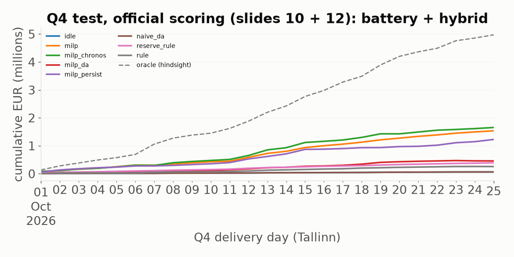

# Results

Generated by `python -m qest.report` from `results/`. EUR over the whole split. Official scoring (organisers' deck v3, slides 10 + 12) covers the deck's two sites: battery 100 MW / 200 MWh + hybrid (PV 20 MW + 20 MW / 40 MWh, 20 MW connection). Baltic and starter modes add the Pihlaka solar park (42.3 MW) and the Paldiski wind park (45 MW).

## Q4 test (1-25 Oct), forecasts refitted on Q1-Q3: official settlement

| strategy     | total EUR   | cap    | da      | mfrr   | afrr   | imbalance   | penalty   | battery   | hybrid   |   undelivered MWh |   % of oracle |
|:-------------|:------------|:-------|:--------|:-------|:-------|:------------|:----------|:----------|:---------|------------------:|--------------:|
| oracle       | 4.97 M      | 0.58 M | 1.02 M  | 1.11 M | 2.45 M | 1 k         | 0 k       | 4.09 M    | 0.88 M   |                 0 |         100   |
| milp_chronos | 1.65 M      | 0.56 M | 0.69 M  | 0.17 M | 0.76 M | -0.24 M     | 0 k       | 1.32 M    | 0.34 M   |                 0 |          33.3 |
| milp         | 1.54 M      | 0.53 M | 0.59 M  | 0.10 M | 0.80 M | -0.15 M     | 0 k       | 1.23 M    | 0.31 M   |                 1 |          30.9 |
| milp_persist | 1.23 M      | 0.54 M | -0.49 M | 0.23 M | 1.10 M | 0.16 M      | 0 k       | 0.96 M    | 0.26 M   |                 2 |          24.7 |
| milp_da      | 0.46 M      | 0 k    | 0.74 M  | 0 k    | 0 k    | 3 k         | 0 k       | 0.32 M    | 0.14 M   |                 0 |           9.2 |
| reserve_rule | 0.39 M      | 0.29 M | 61 k    | 32 k   | -7 k   | -1 k        | 0 k       | 0.27 M    | 0.12 M   |                 6 |           7.8 |
| rule         | 0.26 M      | 0 k    | 0.31 M  | 0 k    | 0 k    | 11 k        | 0 k       | 0.16 M    | 99 k     |                 0 |           5.2 |
| idle         | 61 k        | 0 k    | 0 k     | 0 k    | 0 k    | 27 k        | 0 k       | 0 k       | 61 k     |                 0 |           1.2 |
| naive_da     | 61 k        | 0 k    | 0 k     | 0 k    | 0 k    | 27 k        | 0 k       | 0 k       | 61 k     |                 0 |           1.2 |

## Q4 test (1-25 Oct), forecasts refitted on Q1-Q3: baltic settlement

| strategy     | total EUR   | cap    | da     | mfrr   | afrr   | imbalance   | penalty   | battery   | hybrid   | solar   | wind   |   undelivered MWh |   % of oracle |
|:-------------|:------------|:-------|:-------|:-------|:-------|:------------|:----------|:----------|:---------|:--------|:-------|------------------:|--------------:|
| oracle       | 5.58 M      | 0.45 M | 1.63 M | 1.11 M | 2.43 M | 2 k         | -0 k      | 4.07 M    | 0.89 M   | 0.14 M  | 0.50 M |                 0 |         100   |
| milp         | 2.16 M      | 0.40 M | 1.01 M | 0.11 M | 0.81 M | -0.13 M     | -2 k      | 1.18 M    | 0.32 M   | 0.15 M  | 0.51 M |                10 |          38.8 |
| milp_persist | 1.91 M      | 0.41 M | -90 k  | 0.28 M | 1.06 M | 0.26 M      | -1 k      | 0.99 M    | 0.28 M   | 0.15 M  | 0.52 M |                 5 |          34.2 |
| reserve_rule | 1.00 M      | 0.25 M | 0.65 M | 32 k   | -8 k   | 64 k        | -1 k      | 0.23 M    | 0.12 M   | 0.15 M  | 0.51 M |                 5 |          18   |
| rule         | 0.95 M      | 0 k    | 0.90 M | 0 k    | 0 k    | 75 k        | 0 k       | 0.19 M    | 0.10 M   | 0.15 M  | 0.51 M |                 0 |          17.1 |
| idle         | 0.76 M      | 0 k    | 0 k    | 0 k    | 0 k    | 0.72 M      | 0 k       | 0 k       | 60 k     | 0.15 M  | 0.55 M |                 0 |          13.6 |
| naive_da     | 0.72 M      | 0 k    | 0.59 M | 0 k    | 0 k    | 92 k        | 0 k       | 0 k       | 60 k     | 0.15 M  | 0.51 M |                 0 |          12.9 |

## Q4 test (1-25 Oct), forecasts refitted on Q1-Q3: starter settlement

| strategy     | total EUR   | cap    | da      | mfrr   | afrr   | imbalance   | penalty   | battery   | hybrid   | solar   | wind   |   undelivered MWh |   % of oracle |
|:-------------|:------------|:-------|:--------|:-------|:-------|:------------|:----------|:----------|:---------|:--------|:-------|------------------:|--------------:|
| oracle       | 5.57 M      | 0.45 M | 1.63 M  | 1.11 M | 2.43 M | -1 k        | 0 k       | 4.07 M    | 0.89 M   | 0.14 M  | 0.50 M |                 0 |         100   |
| milp         | 1.87 M      | 0.40 M | 0.90 M  | 0.11 M | 0.81 M | -0.32 M     | 0 k       | 1.07 M    | 0.29 M   | 0.11 M  | 0.41 M |                10 |          33.5 |
| milp_persist | 1.72 M      | 0.41 M | -0.20 M | 0.28 M | 1.06 M | 0.19 M      | 0 k       | 0.99 M    | 0.26 M   | 98 k    | 0.41 M |                 5 |          30.9 |
| reserve_rule | 0.83 M      | 0.25 M | 0.65 M  | 32 k   | -8 k   | -0.11 M     | 0 k       | 0.23 M    | 0.12 M   | 97 k    | 0.38 M |                 5 |          14.8 |
| rule         | 0.77 M      | 0 k    | 0.90 M  | 0 k    | 0 k    | -0.11 M     | 0 k       | 0.19 M    | 95 k     | 97 k    | 0.38 M |                 0 |          13.8 |
| naive_da     | 0.53 M      | 0 k    | 0.59 M  | 0 k    | 0 k    | -93 k       | 0 k       | 0 k       | 51 k     | 97 k    | 0.38 M |                 0 |           9.5 |
| idle         | 0.37 M      | 0 k    | 0 k     | 0 k    | 0 k    | 0.34 M      | 0 k       | 0 k       | 51 k     | 68 k    | 0.25 M |                 0 |           6.6 |

## Q3 validation, forecasts fitted on Q1-Q2: official settlement

| strategy     | total EUR   | cap    | da      | mfrr   | afrr   | imbalance   | penalty   | battery   | hybrid   |   undelivered MWh |   % of oracle |
|:-------------|:------------|:-------|:--------|:-------|:-------|:------------|:----------|:----------|:---------|------------------:|--------------:|
| oracle       | 21.26 M     | 2.96 M | 3.81 M  | 5.35 M | 9.99 M | 20 k        | 0 k       | 17.44 M   | 3.82 M   |                 0 |         100   |
| milp         | 6.81 M      | 2.28 M | -3.27 M | 1.35 M | 6.35 M | 0.74 M      | 0 k       | 5.31 M    | 1.50 M   |                 1 |          32   |
| milp_chronos | 5.64 M      | 2.74 M | 3.52 M  | 0.32 M | 1.57 M | -1.53 M     | 0 k       | 4.38 M    | 1.26 M   |                22 |          26.5 |
| milp_persist | 5.37 M      | 2.42 M | -1.02 M | 1.13 M | 3.50 M | 0.54 M      | 0 k       | 4.12 M    | 1.25 M   |                 8 |          25.3 |
| reserve_rule | 2.19 M      | 1.75 M | 0.34 M  | 38 k   | 0 k    | 13 k        | 0 k       | 1.51 M    | 0.68 M   |                 5 |          10.3 |
| milp_da      | 1.59 M      | 0 k    | 2.73 M  | 0 k    | 0 k    | 7 k         | 0 k       | 0.97 M    | 0.62 M   |                 0 |           7.5 |
| rule         | 0.92 M      | 0 k    | 1.15 M  | 0 k    | 0 k    | 40 k        | 0 k       | 0.45 M    | 0.47 M   |                 0 |           4.3 |
| idle         | 0.38 M      | 0 k    | 0 k     | 0 k    | 0 k    | 0.27 M      | 0 k       | 0 k       | 0.38 M   |                 0 |           1.8 |
| naive_da     | 0.38 M      | 0 k    | 0 k     | 0 k    | 0 k    | 0.27 M      | 0 k       | 0 k       | 0.38 M   |                 0 |           1.8 |

## Q3 validation, forecasts fitted on Q1-Q2: baltic settlement

| strategy     | total EUR   | cap    | da      | mfrr   | afrr    | imbalance   | penalty   | battery   | hybrid   | solar   | wind   |   undelivered MWh |   % of oracle |
|:-------------|:------------|:-------|:--------|:-------|:--------|:------------|:----------|:----------|:---------|:--------|:-------|------------------:|--------------:|
| oracle       | 22.75 M     | 2.34 M | 5.28 M  | 5.35 M | 10.01 M | 26 k        | -0 k      | 17.32 M   | 3.82 M   | 0.75 M  | 0.90 M |                 0 |         100   |
| milp         | 8.68 M      | 1.92 M | -2.19 M | 1.35 M | 6.57 M  | 0.94 M      | -0 k      | 5.52 M    | 1.55 M   | 0.82 M  | 0.87 M |                 0 |          38.1 |
| milp_persist | 7.20 M      | 1.83 M | 42 k    | 1.07 M | 3.61 M  | 0.76 M      | -1 k      | 4.24 M    | 1.34 M   | 0.83 M  | 0.87 M |                 9 |          31.6 |
| reserve_rule | 3.77 M      | 1.63 M | 1.99 M  | 35 k   | 0 k     | 49 k        | -1 k      | 1.42 M    | 0.67 M   | 0.82 M  | 0.87 M |                 6 |          16.6 |
| rule         | 2.80 M      | 0 k    | 2.81 M  | 0 k    | 0 k     | 71 k        | 0 k       | 0.63 M    | 0.47 M   | 0.82 M  | 0.87 M |                 0 |          12.3 |
| idle         | 2.65 M      | 0 k    | 0 k     | 0 k    | 0 k     | 2.55 M      | 0 k       | 0 k       | 0.38 M   | 1.02 M  | 1.26 M |                 0 |          11.7 |
| naive_da     | 2.07 M      | 0 k    | 1.66 M  | 0 k    | 0 k     | 0.31 M      | 0 k       | 0 k       | 0.38 M   | 0.82 M  | 0.87 M |                 0 |           9.1 |

## Q3 validation, forecasts fitted on Q1-Q2: starter settlement

| strategy     | total EUR   | cap    | da      | mfrr   | afrr    | imbalance   | penalty   | battery   | hybrid   | solar   | wind   |   undelivered MWh |   % of oracle |
|:-------------|:------------|:-------|:--------|:-------|:--------|:------------|:----------|:----------|:---------|:--------|:-------|------------------:|--------------:|
| oracle       | 22.72 M     | 2.34 M | 5.28 M  | 5.35 M | 10.01 M | -4 k        | 0 k       | 17.32 M   | 3.81 M   | 0.74 M  | 0.89 M |                 0 |         100   |
| milp         | 8.07 M      | 1.92 M | -2.57 M | 1.35 M | 6.57 M  | 0.71 M      | 0 k       | 5.54 M    | 1.36 M   | 0.55 M  | 0.70 M |                 0 |          35.5 |
| milp_persist | 6.29 M      | 1.83 M | -0.54 M | 1.07 M | 3.61 M  | 0.43 M      | 0 k       | 4.07 M    | 1.12 M   | 0.53 M  | 0.66 M |                 9 |          27.7 |
| reserve_rule | 3.01 M      | 1.63 M | 1.99 M  | 35 k   | 0 k     | -0.71 M     | 0 k       | 1.42 M    | 0.63 M   | 0.43 M  | 0.55 M |                 6 |          13.3 |
| rule         | 2.02 M      | 0 k    | 2.81 M  | 0 k    | 0 k     | -0.71 M     | 0 k       | 0.63 M    | 0.41 M   | 0.43 M  | 0.55 M |                 0 |           8.9 |
| naive_da     | 1.21 M      | 0 k    | 1.66 M  | 0 k    | 0 k     | -0.56 M     | 0 k       | 0 k       | 0.23 M   | 0.43 M  | 0.55 M |                 0 |           5.3 |
| idle         | 1.05 M      | 0 k    | 0 k     | 0 k    | 0 k     | 0.94 M      | 0 k       | 0 k       | 0.23 M   | 0.37 M  | 0.45 M |                 0 |           4.6 |

## RL: PPO (Stable-Baselines3) choosing the MILP knobs per day (qest.gym_env), official scoring

Trained on Q3 days only (so its Q3 figure is in-sample); Q4 scored once with the deterministic policy.

| split   | EUR    |   mean kappa_up |   mean kappa_dn |   mean tol |
|:--------|:-------|----------------:|----------------:|-----------:|
| test    | 1.49 M |               1 |               0 |      0.076 |
| val     | 7.07 M |               1 |               0 |      0.077 |

## Gate-A forecast MAE (val = Q3 fitted on Q1-Q2; test = Q4, LightGBM/persistence chosen per target on Q3)

|               |   ('val', 'Chronos-2') |   ('val', 'LightGBM') |   ('val', 'persistence') |   ('test', 'Chronos-2') |   ('test', 'LightGBM') |   ('test', 'persistence') |
|:--------------|-----------------------:|----------------------:|-------------------------:|------------------------:|-----------------------:|--------------------------:|
| da            |                  32.73 |                 40.27 |                    49.58 |                   36.04 |                  42.47 |                     55.77 |
| cap_afrr_up   |                   1.95 |                  2.78 |                     3    |                    2.7  |                   2.96 |                      3.64 |
| cap_afrr_down |                   4.16 |                  5.45 |                     6.49 |                    1.35 |                   1.43 |                      1.8  |
| cap_mfrr_up   |                   3.83 |                  6.23 |                     5.83 |                    3.05 |                   4.25 |                      4.25 |
| cap_mfrr_down |                   3.78 |                 10.52 |                     5.59 |                    1.17 |                   1.61 |                      1.61 |
| mfrr          |                  68.05 |                 71.89 |                    94.45 |                   67.41 |                  66.03 |                     93.7  |
| imb           |                  72.55 |                 75.57 |                   100.74 |                   64.65 |                  62.88 |                     91.98 |
| afrr_up_p     |                  54.85 |                 52.1  |                    76.86 |                   56.25 |                  55.12 |                     81.23 |
| afrr_dn_p     |                  54.16 |                 53.31 |                    73.08 |                   61.8  |                  62.35 |                     85.39 |
| afrr_up_s     |                   0.37 |                  0.37 |                     0.42 |                    0.34 |                   0.34 |                      0.41 |
| afrr_dn_s     |                   0.35 |                  0.37 |                     0.41 |                    0.32 |                   0.33 |                      0.4  |

## Quantum track: the portfolio puzzle (slide 11), retrospective, every Q4 hour

Prices known (slide 9): each solver's plan as a share of the exact classical optimum; infeasible plans score 0. "optimum hit" = the returned plan is the optimum; "P(optimum)" = probability mass on it in the simulated quantum state, before the shared one-bit polish. "random + polish" is the control: random bits through the same polish.

| level   |   qubits |   n | method              | EUR    |   % of optimum |   optimum hit |   P(optimum) in quantum state |   s/instance |
|:--------|---------:|----:|:--------------------|:-------|---------------:|--------------:|------------------------------:|-------------:|
| P1      |        9 | 600 | exact (classical)   | 1.77 M |         100    |         1     |                       nan     |      6.4e-05 |
| P1      |        9 | 600 | simulated annealing | 1.77 M |         100    |         1     |                       nan     |      0.019   |
| P1      |        9 | 600 | tabu search         | 1.77 M |         100    |         1     |                       nan     |      0.048   |
| P1      |        9 | 600 | random + polish     | 0.27 M |          14.96 |         0.29  |                       nan     |      0.00023 |
| P1      |        9 | 600 | random, 4096 shots  | 1.77 M |         100    |         1     |                       nan     |      2.3e-05 |
| P1      |        9 | 600 | QAOA p=1            | 1.77 M |         100    |         1     |                         0.028 |      0.0021  |
| P1      |        9 | 600 | QAOA p=3            | 1.77 M |         100    |         1     |                         0.063 |      0.002   |
| P1      |        9 | 600 | simulated QA        | 1.77 M |         100    |         1     |                       nan     |      0.00045 |
| P1      |        9 | 600 | BF-DCQO             | 1.77 M |         100    |         1     |                         0.516 |      0.0043  |
| P1      |        9 | 600 | FALQON              | 1.77 M |         100    |         1     |                         0.342 |      0.00012 |
| P1      |        9 | 600 | PCE                 | 1.73 M |          97.81 |         0.863 |                       nan     |      0.0048  |
| P2      |       15 | 600 | exact (classical)   | 2.56 M |         100    |         1     |                       nan     |      0.00046 |
| P2      |       15 | 600 | simulated annealing | 2.51 M |          98.11 |         0.68  |                       nan     |      0.033   |
| P2      |       15 | 600 | tabu search         | 2.56 M |          99.98 |         0.988 |                       nan     |      0.048   |
| P2      |       15 | 600 | random + polish     | 0.92 M |          35.9  |         0.203 |                       nan     |      0.00024 |
| P2      |       15 | 600 | random, 4096 shots  | 2.10 M |          81.94 |         0.292 |                       nan     |      2.4e-05 |
| P2      |       15 | 600 | QAOA p=1            | 2.56 M |         100    |         1     |                         0.004 |      0.015   |
| P2      |       15 | 600 | QAOA p=3            | 2.56 M |         100    |         1     |                         0.009 |      0.041   |
| P2      |       15 | 600 | simulated QA        | 2.56 M |         100    |         1     |                       nan     |      0.00072 |
| P2      |       15 | 600 | BF-DCQO             | 2.56 M |         100    |         1     |                         0.15  |      0.02    |
| P2      |       15 | 600 | FALQON              | 2.56 M |         100    |         1     |                         0.022 |      0.012   |
| P2      |       15 | 600 | PCE                 | 2.43 M |          94.91 |         0.492 |                       nan     |      0.0071  |
| P3      |       30 | 300 | exact (classical)   | 1.90 M |         100    |         1     |                       nan     |      0.1     |
| P3      |       30 | 300 | simulated annealing | 0.88 M |          46.12 |         0.003 |                       nan     |      0.064   |
| P3      |       30 | 300 | tabu search         | 1.90 M |          99.92 |         0.907 |                       nan     |      0.048   |
| P3      |       30 | 300 | random + polish     | 0.65 M |          34.03 |         0.043 |                       nan     |      0.00046 |
| P3      |       30 | 300 | random, 4096 shots  | 0.59 M |          30.79 |         0.01  |                       nan     |      8.9e-05 |
| P3      |       30 | 300 | PCE                 | 1.61 M |          84.49 |         0.017 |                       nan     |      0.017   |

P3 revisited (11 Nov 2026, `qest.qubo --level P3`, 300 Q4 instances, results/qubo_P3_test_retro.csv): the gate-model
solvers run partitioned, one block pinned into the other's linear terms, blocks alternating between the two hours (15 qubits)
and the three sites across both hours (10 qubits, the SoC link inside), up to 4 sweeps, 4 random one-hot restarts.

| level | qubits | method | % of optimum | optimum hit | s/instance |
|:--|--:|:--|--:|--:|--:|
| P3 | 6 | PCE, one-hot decoding | 84.50 | 0.017 | 0.013 |
| P3 | 8 | PCE, 48 restarts | 86.61 | 0.000 | 0.03 |
| P3 | 15 | partitioned by hour (QAOA p=1 / BF-DCQO / FALQON / SQA, identical) | 92.05 | 0.730 | 0.01-0.2 |
| P3 | 15 / 10 | partitioned, alternating hour / site blocks | 99.67 | 0.977 | 0.02-0.4 |
| P3 | 15 / 10 | alternating blocks, 4 restarts | **99.92** | **0.993** | 0.1-1.5 |
| P3 | 30 | tabu search (classical reference) | 99.92 | 0.907 | 0.048 |

## MILP knobs tuned by Optuna (TPE) on Q3, official scoring, battery + hybrid

|   number |       value |   params_afrr |   params_mfrr |   params_kappa_up |   params_kappa_dn |   params_tol |
|---------:|------------:|--------------:|--------------:|------------------:|------------------:|-------------:|
|       44 | 6.80819e+06 |            25 |       124.512 |             0.991 |             0.6   |        0.092 |
|       60 | 6.75127e+06 |            25 |        73.299 |             0.958 |             0.591 |        0.105 |
|       41 | 6.71337e+06 |            25 |        57.089 |             0.987 |             0.663 |        0.105 |
|       62 | 6.70302e+06 |            25 |        64.113 |             0.982 |             0.511 |        0.036 |
|       43 | 6.67304e+06 |            25 |        96.616 |             0.988 |             0.571 |        0.039 |
|       54 | 6.6626e+06  |            25 |       116.125 |             0.927 |             0.441 |        0.035 |
|       59 | 6.64701e+06 |            25 |       121.948 |             0.913 |             0.569 |        0.055 |
|       61 | 6.64108e+06 |            25 |       190.616 |             0.984 |             0.494 |        0.056 |

